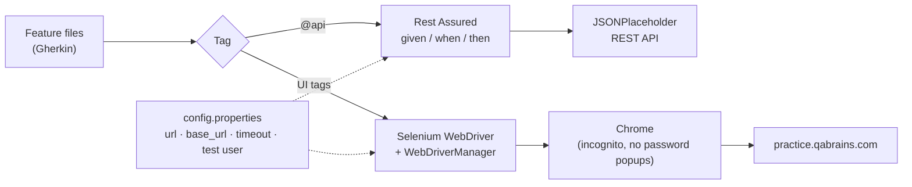

<div align="center">

# 🔌 QaBrains API Automation — Rest Assured

### Hybrid BDD suite: REST API tests with Rest Assured + UI tests with Selenium, written in Cucumber

[](https://git.io/typing-svg)

<!-- ============ STATUS BAR ============ -->
[](https://github.com/rbchy/QaBrainsAPIAutomationRestAssured/actions/workflows/tests.yml)
-22c55e?style=for-the-badge&logo=checkmarx&logoColor=white)


</div>

---

## 📌 At a Glance

<table>
<tr>
<td width="50%" valign="top">

**🙋 What this is**

One Cucumber project that tests a system from **two sides**: the **REST API** layer (create, read, update, delete and an invalid-endpoint check, sent with **Rest Assured**) and the **web UI** (login, registration, cart, forgot password and navigation, driven with **Selenium**). Every scenario is plain-English **Gherkin** and is tagged so a smoke run, a regression run or a single module can be picked from the command line.

> *An API that answers 200 and a page that shows nothing is still a defect — test both.*

</td>
<td width="50%" valign="top">

**📍 Quick facts**

| | |
|---|---|
| 🔌 **API target** | [jsonplaceholder.typicode.com](https://jsonplaceholder.typicode.com) |
| 🌐 **UI target** | [practice.qabrains.com](https://practice.qabrains.com/) |
| 🧪 **Scenarios** | 20 in 12 feature files |
| ✅ **CI** | GitHub Actions · API + headless Chrome |
| 🏷️ **Suites** | `@smoke` · `@regression` · `@api` · `@Cart` |
| ⚙️ **Config** | `src/test/resources/config.properties` |

</td>
</tr>
</table>

---

## ✅ Latest Results

Every push runs both packs in **GitHub Actions** ([workflow](.github/workflows/tests.yml)): the API job against JSONPlaceholder and the UI job in headless Chrome against practice.qabrains.com.

| Pack | Runner | Scenarios | Result |
|---|---|---:|---|
| 🔌 API | `ApiRunner` (`@api`) | 5 |  |
| 🌐 UI | `UiRunner` (`not @api`) | 15 |  |

On a failed UI scenario the report gets a **screenshot and the page HTML**, also saved under `target/failures/` and uploaded as a CI artifact.

---

## 🧭 How It Fits Together



---

## 🔌 API Coverage

| # | Feature file | Scenario | Request | Checks |
|---|---|---|---|---|
| 1 | `APIgetUser.feature` | Get user details | `GET /users/1` | 200 · JSON · **JSON Schema** · id = 1 |
| 2 | `APIcreateUser.feature` | Create a user | `POST /users` | 201 · new id · name / username / email echoed |
| 3 | `APIupdateUser.feature` | Update a user | `PUT /users/1` | 200 · id = 1 · updated fields echoed |
| 4 | `APIdeleteUser.feature` | Delete a user | `DELETE /users/1` | 200 · empty JSON body |
| 5 | `APInegativeTest.feature` | Call an invalid endpoint | `GET /this-endpoint-does-not-exist` | 404 |

Every request also checks the **response time** (limit in `testdata.json`) and attaches the pretty-printed response to the Cucumber report. Payloads come from [`testdata.json`](src/test/resources/testdata.json); the schema is [`schemas/user-schema.json`](src/test/resources/schemas/user-schema.json).

Every API scenario follows the same shape:

```gherkin
Given API base URI is set          # base_url from config.properties
When I create a user               # Rest Assured request
Then API response should be valid  # status code + response body checks
```

---

## 🌐 UI Coverage

<details open>
<summary><strong>🔐 Login · Logout · Registration · Forgot Password</strong></summary>

<br>

| Feature | Scenarios | Positive / Negative |
|---|---|---|
| `Login.feature` | Valid credentials · invalid credentials | ✅ / ❌ |
| `Logout.feature` | Logged-in user logs out | ✅ |
| `Registration.feature` | Register with a valid email · reject an email without `@` | ✅ / ❌ |
| `ForgotPassword.feature` | Reset for a registered email · reject a malformed email | ✅ / ❌ |

</details>

<details>
<summary><strong>🛒 E-commerce demo (cart & products)</strong></summary>

<br>

All shop scenarios first log in to the shop at `/ecommerce/login` with its public practice account.

| Feature | Scenarios |
|---|---|
| `CartCheckout.feature` | Add a product → it is marked *Remove from cart* · add then remove → cart is empty |
| `RegressionTests.feature` | R-01 add 3 products → 3 in the cart · R-02 product details page shows name and price · R-03 every product card has a name, a price and an *Add to cart* button |

</details>

<details>
<summary><strong>💨 Smoke pack</strong></summary>

<br>

| Scenario | Check |
|---|---|
| S-01 | Home page loads |
| S-02 | Registration, Forgot Password, Form Submission and Drag and Drop List open from the sidebar menu |
| S-03 | The E-Commerce demo site opens from the menu |

</details>

---

## 🛠️ Tech Stack

| Layer | Technology | Purpose |
|---|---|---|
| Language | Java 17 | Test code |
| API testing | Rest Assured 5.5 + JSON Schema Validator | Fluent `given / when / then` requests, schema checks |
| UI testing | Selenium WebDriver 4.25 | Drives Chrome (headless in CI) |
| Driver management | WebDriverManager | Downloads the matching ChromeDriver automatically |
| BDD | Cucumber 7.15 (Gherkin) | Readable scenarios shared by API and UI |
| Runner | TestNG 7.9 | Executes Cucumber scenarios |
| CI | GitHub Actions | API and UI jobs, reports uploaded as artifacts |
| Build | Maven | Dependencies and `mvn test` |
| Config | Java `Properties` | Environment values in one file |

---

## 📁 Project Structure

```
QaBrainsAPIAutomationRestAssured/
├── src/test/java/utils/
│   ├── BaseTest.java            ← config.properties, Chrome setup (incognito, headless switch)
│   ├── DriverFactory.java       ← ThreadLocal driver, ready for parallel runs
│   └── DriverHelper.java
├── src/test/java/api/
│   ├── ApiClient.java           ← one RequestSpecification: base URI, JSON, log on failure
│   └── TestData.java            ← reads testdata.json
├── src/test/java/pages/         ← Login, Logout, Registration, ForgotPassword, Ecommerce
├── src/test/java/stepdefinitions/
│   ├── ApiSteps.java            ← Rest Assured steps and checks
│   ├── AuthSteps.java · RegistrationSteps.java · ForgotPasswordSteps.java
│   ├── ShopSteps.java           ← cart, product details, menu navigation
│   ├── CommonSteps.java
│   └── Hooks.java               ← browser only for non-@api; screenshot + HTML on failure
├── src/test/java/runners/       ← TestRunner · ApiRunner · UiRunner
├── src/test/resources/
│   ├── config.properties        ← UI url, browser, timeout, test user, API base_url
│   ├── testdata.json            ← API payloads, ids, response-time limit
│   ├── schemas/user-schema.json ← JSON Schema for GET /users/{id}
│   └── features/
│       ├── APIgetUser.feature        APIcreateUser.feature
│       ├── APIupdateUser.feature     APIdeleteUser.feature
│       ├── APInegativeTest.feature
│       ├── Login.feature             Logout.feature
│       ├── Registration.feature      ForgotPassword.feature
│       ├── CartCheckout.feature
│       ├── SmokeTests.feature        RegressionTests.feature
├── .github/workflows/tests.yml  ← API and UI jobs on every push
├── pom.xml
└── README.md
```

---

## ⚙️ Configuration

`src/test/resources/config.properties`

```properties
# UI
url=https://practice.qabrains.com/
browser=chrome
timeout=10

# API
base_url=https://jsonplaceholder.typicode.com
```

The UI test users (`valid_email` / `valid_password`, `shop_email` / `shop_password`) are the public practice accounts published by QA Brains — no real personal data is used. Add `headless=true` (or `-Dheadless=true`) to run Chrome without a window.

---

## ▶️ Running the Tests

```bash
git clone https://github.com/rbchy/QaBrainsAPIAutomationRestAssured.git
cd QaBrainsAPIAutomationRestAssured

# Everything (@smoke or @regression)
mvn clean test

# API pack / UI pack
mvn clean test -Dtest=ApiRunner
mvn clean test -Dtest=UiRunner -Dheadless=true

# Smoke pack / regression pack
mvn clean test -Dcucumber.filter.tags="@smoke"
mvn clean test -Dcucumber.filter.tags="@regression"

# One module
mvn clean test -Dcucumber.filter.tags="@Login or @Registration"
```

---

## 🏷️ Tags

| Tag | Meaning |
|---|---|
| `@smoke` | Critical path — quick build check |
| `@regression` | Full suite |
| `@api` | All Rest Assured scenarios |
| `@get` `@create` `@update` `@delete` `@negative` | One API operation |
| `@Login` `@Logout` `@Registration` `@ForgotPassword` `@Cart` `@Shop` | One UI module |

---

## 📈 Roadmap

- [x] `pom.xml`, step definitions, hooks and runners
- [x] API checks: status, response time, JSON fields, JSON Schema
- [x] GitHub Actions running the API and UI packs on every push
- [ ] Request / response POJOs instead of maps
- [ ] Allure report published to GitHub Pages
- [ ] Parallel UI runs with the ThreadLocal `DriverFactory`
- [ ] Form Submission and Drag and Drop scenarios

---

## 🔗 Related Projects

| Project | Stack |
|---|---|
| ⭐ [RbcTcsWorld E-Commerce Suite](https://github.com/rbchy/RbcTcsWorld_ECommerceSuite) | Spring Boot · REST Assured · Selenium · Playwright · CI quality gates |
| 🔌 [API — Postman / Newman](https://github.com/rbchy/QaBrainsAPIAutomation_Postman) | Postman · Newman |
| 🔬 [QA Brains — Java + Playwright](https://github.com/rbchy/QaBrainsAutomationJavaPlaywright) | Java 17 · Playwright · Cucumber JVM · TestNG |
| 🏥 [OpenEMR Healthcare](https://github.com/rbchy/OpenEMR_Automation) | Java · Selenium · Cucumber · TestNG |

<sub>All projects: [github.com/rbchy](https://github.com/rbchy)</sub>

---

## 👤 Author

<div align="center">

**Ranajit Baran Chowdhury (RB Chowdhury)**
QA Automation Engineer / SDET · West Norriton, Pennsylvania, USA

[](https://www.linkedin.com/in/rbchy/)
[](https://github.com/rbchy)
[](https://rbchy.github.io/rbchy/)
[](https://rbc6543.wixsite.com/rbc-portfolio)
[](mailto:chyranajit@gmail.com)

<sub>Provided for educational and professional QA automation purposes. JSONPlaceholder and QA Brains are public practice services.</sub>

⭐ *If this project helps you, a star on the repo is appreciated.*

</div>
