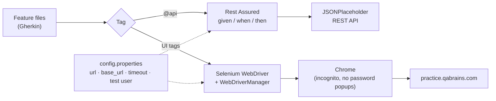

<div align="center">

# 🔌 QaBrains API Automation — Rest Assured

### Hybrid BDD suite: REST API tests with Rest Assured + UI tests with Selenium, written in Cucumber

[](https://git.io/typing-svg)

<!-- ============ STATUS BAR ============ -->

-155e75?style=for-the-badge)


</div>

---

## 📌 At a Glance

<table>
<tr>
<td width="50%" valign="top">

**🙋 What this is**

One Cucumber project that tests a system from **two sides**: the **REST API** layer (create, read, update, delete and an invalid-endpoint check, sent with **Rest Assured**) and the **web UI** (login, registration, cart, forgot password and navigation, driven with **Selenium**). Every scenario is plain-English **Gherkin** and is tagged so a smoke run, a regression run or a single module can be picked from the command line.

> *An API that answers 200 and a page that shows nothing is still a defect — test both.*

</td>
<td width="50%" valign="top">

**📍 Quick facts**

| | |
|---|---|
| 🔌 **API target** | [jsonplaceholder.typicode.com](https://jsonplaceholder.typicode.com) |
| 🌐 **UI target** | [practice.qabrains.com](https://practice.qabrains.com/) |
| 🧪 **Scenarios** | 21 in 13 feature files |
| 🏷️ **Suites** | `@smoke` · `@regression` · `@api` |
| ⚙️ **Config** | `src/test/resources/config.properties` |

</td>
</tr>
</table>

---

## 🧭 How It Fits Together



---

## 🔌 API Coverage

| # | Feature file | Scenario | Method | Tags |
|---|---|---|---|---|
| 1 | `APIgetUser.feature` | Get user details | `GET` | `@smoke @regression @api @get` |
| 2 | `APIcreateUser.feature` | Create a user | `POST` | `@smoke @regression @api @create` |
| 3 | `APIupdateUser.feature` | Update a user | `PUT` | `@smoke @regression @api @update` |
| 4 | `APIdeleteUser.feature` | Delete a user | `DELETE` | `@smoke @regression @api @delete` |
| 5 | `APInegativeTest.feature` | Call an invalid endpoint → error expected | `GET` | `@smoke @regression @api @negative` |
| 6 | `APITest.feature` | Update user (combined API feature) | `PUT` | `@smoke @regression` |

Every API scenario follows the same shape:

```gherkin
Given API base URI is set          # base_url from config.properties
When I create a user               # Rest Assured request
Then API response should be valid  # status code + response body checks
```

---

## 🌐 UI Coverage

<details open>
<summary><strong>🔐 Login · Logout · Registration · Forgot Password</strong></summary>

<br>

| Feature | Scenarios | Positive / Negative |
|---|---|---|
| `Login.feature` | Valid credentials · invalid credentials | ✅ / ❌ |
| `Logout.feature` | Logged-in user logs out | ✅ |
| `Registration.feature` | Register with a valid email · reject an email without `@` | ✅ / ❌ |
| `ForgotPassword.feature` | Reset for a registered email · reject a malformed email | ✅ / ❌ |

</details>

<details>
<summary><strong>🛒 Cart</strong></summary>

<br>

| Feature | Scenarios |
|---|---|
| `CartCheckout.feature` | Add a product to the cart · remove it and confirm the cart is empty |

</details>

<details>
<summary><strong>💨 Smoke & Regression packs</strong></summary>

<br>

| Feature | Scenarios |
|---|---|
| `SmokeTests.feature` | S-01 home page loads · S-02 Catalog / About / Blog navigation · S-03 Wish list and Refer a Friend |
| `RegressionTests.feature` | R-01 add multiple products · R-02 update quantity · R-03 search for an item that does not exist |

</details>

---

## 🛠️ Tech Stack

| Layer | Technology | Purpose |
|---|---|---|
| Language | Java | Test code |
| API testing | Rest Assured | Fluent `given / when / then` HTTP requests and assertions |
| UI testing | Selenium WebDriver | Drives Chrome |
| Driver management | WebDriverManager | Downloads the matching ChromeDriver automatically |
| BDD | Cucumber (Gherkin) | Readable scenarios shared by API and UI |
| Runner | TestNG | Executes Cucumber scenarios |
| Build | Maven | Dependencies and `mvn test` |
| Config | Java `Properties` | Environment values in one file |

---

## 📁 Project Structure

```
QaBrainsAPIAutomationRestAssured/
├── src/test/java/utils/
│   ├── BaseTest.java            ← loads config.properties, Chrome setup (incognito,
│   │                              password-manager popups off, waits), health check
│   ├── DriverFactory.java       ← ThreadLocal driver, ready for parallel runs
│   └── DriverHelper.java        ← simple local-driver helper
├── src/test/resources/
│   ├── config.properties        ← UI url, browser, timeout, test user, API base_url
│   ├── testdata.json            ← test data file
│   └── features/
│       ├── APIgetUser.feature        APIcreateUser.feature
│       ├── APIupdateUser.feature     APIdeleteUser.feature
│       ├── APInegativeTest.feature   APITest.feature
│       ├── Login.feature             Logout.feature
│       ├── Registration.feature      ForgotPassword.feature
│       ├── CartCheckout.feature
│       ├── SmokeTests.feature        RegressionTests.feature
└── README.md
```

> 🚧 **Repository status:** this repository currently holds the feature files, configuration and driver utilities. The Maven `pom.xml`, step definitions and Cucumber runners are being added next — see the roadmap.

---

## ⚙️ Configuration

`src/test/resources/config.properties`

```properties
# UI
url=https://practice.qabrains.com/
browser=chrome
timeout=10

# API
base_url=https://jsonplaceholder.typicode.com
```

The UI test user (`valid_email`, `valid_password`) is the public practice account published by QA Brains — no real personal data is used.

---

## ▶️ Running the Tests

*(once `pom.xml` and the runners are committed)*

```bash
git clone https://github.com/rbchy/QaBrainsAPIAutomationRestAssured.git
cd QaBrainsAPIAutomationRestAssured

# Everything
mvn clean test

# API only
mvn clean test -Dcucumber.filter.tags="@api"

# Smoke pack / regression pack
mvn clean test -Dcucumber.filter.tags="@smoke"
mvn clean test -Dcucumber.filter.tags="@regression"

# One module
mvn clean test -Dcucumber.filter.tags="@Login or @Registration"
```

---

## 🏷️ Tags

| Tag | Meaning |
|---|---|
| `@smoke` | Critical path — quick build check |
| `@regression` | Full suite |
| `@api` | All Rest Assured scenarios |
| `@get` `@create` `@update` `@delete` `@negative` | One API operation |
| `@Login` `@Logout` `@Registration` `@ForgotPassword` | One UI module |

---

## 📈 Roadmap

- [ ] Commit `pom.xml` (Rest Assured, Cucumber, TestNG, Selenium, WebDriverManager)
- [ ] Commit step definitions, hooks and Cucumber runners
- [ ] API assertions on status code, response time and JSON fields; JSON Schema validation
- [ ] Request / response POJOs instead of raw JSON
- [ ] Cucumber HTML + Allure reports
- [ ] GitHub Actions workflow running the API pack on every push
- [ ] Clean-up: merge `APITest.feature` into `APIupdateUser.feature`; align the expected text in the malformed-email Forgot Password scenario with the email it sends

---

## 🔗 Related Projects

| Project | Stack |
|---|---|
| ⭐ [RbcTcsWorld E-Commerce Suite](https://github.com/rbchy/RbcTcsWorld_ECommerceSuite) | Spring Boot · REST Assured · Selenium · Playwright · CI quality gates |
| 🔌 [API — Postman / Newman](https://github.com/rbchy/QaBrainsAPIAutomation_Postman) | Postman · Newman |
| 🔬 [QA Brains — Java + Playwright](https://github.com/rbchy/QaBrainsAutomationJavaPlaywright) | Java 17 · Playwright · Cucumber JVM · TestNG |
| 🏥 [OpenEMR Healthcare](https://github.com/rbchy/OpenEMR_Automation) | Java · Selenium · Cucumber · TestNG |

<sub>All projects: [github.com/rbchy](https://github.com/rbchy)</sub>

---

## 👤 Author

<div align="center">

**Ranajit Baran Chowdhury (RB Chowdhury)**
QA Automation Engineer / SDET · West Norriton, Pennsylvania, USA

[](https://www.linkedin.com/in/rbchy/)
[](https://github.com/rbchy)
[](https://rbchy.github.io/rbchy/)
[](https://rbc6543.wixsite.com/rbc-portfolio)
[](mailto:chyranajit@gmail.com)

<sub>Provided for educational and professional QA automation purposes. JSONPlaceholder and QA Brains are public practice services.</sub>

⭐ *If this project helps you, a star on the repo is appreciated.*

</div>
